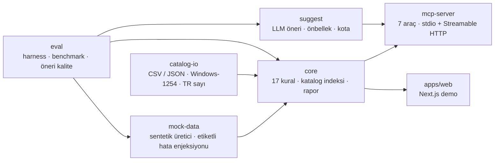

# pazaryeri-denetci-mcp

**Pazaryeri ürün kataloğunu deterministik kurallarla denetleyen, bulguları önem sırasına göre
raporlayan ve bunu bir MCP sunucusu üzerinden AI ajanlarına açan açık kaynak araç.**

[](https://github.com/acar32furkan-glitch/pazaryeri-denetci-mcp/actions/workflows/ci.yml)


Depo: **[github.com/acar32furkan-glitch/pazaryeri-denetci-mcp](https://github.com/acar32furkan-glitch/pazaryeri-denetci-mcp)**
· sürüm: **[v0.1.0 release](https://github.com/acar32furkan-glitch/pazaryeri-denetci-mcp/releases/tag/v0.1.0)**
· CI: GitHub Actions'ta yeşil (lint · format · typecheck · derleme · 286 test · eval kapısı · web derlemesi)

> **Durum: Faz 0–5 tamam.** 17 denetim kuralı, CSV içe aktarma, **7 araçlı** MCP sunucusu (stdio +
> Streamable HTTP), Next.js demosu ve LLM öneri katmanı çalışıyor; ölçülmüş sonuçlar aşağıda.
> Kalan tek adım **yayın**: canlı demo (Vercel) ve GitHub push — ikisi de hesap girişi bekliyor.

Bu depodaki tüm katalog verisi **sentetiktir**; gerçek bir markanın ürün, fiyat veya stok verisi
içermez (bkz. `docs/DECISIONS.md`, ADR-003).

## Canlı demo

> 🚧 **Yayın bekliyor.** Next.js demosu çalışır ve testlidir (`next build` ile 4 rota), ancak Vercel
> yayını bu makinede oturum açılmadığı için yapılmadı. Yayın sonrası canlı bağlantı buraya eklenir —
> uydurma bir bağlantı **konmaz**.

Demoyu yerelde üç komutla çalıştırabilirsiniz:

```bash
pnpm install
pnpm --filter @pazaryeri-denetci/web run build
pnpm --filter @pazaryeri-denetci/web run start   # http://localhost:3000
```

Demo üç sentetik katalog profilinden birini seçip denetimi çalıştırır; özet kartlarını, en sık 5
kuralı ve en kritik 20 bulguyu gösterir. Sonuç JSON (`/api/denetim`) ve Türkçe Markdown raporu
(`/api/rapor`) olarak indirilebilir.

## 60–90 saniyelik demo

Ekran kaydı senaryosu (sahne sahne: komutlar, ekranda görünecekler, anlatım metni):
**[docs/DEMO.md](docs/DEMO.md)**. Kayıt henüz alınmadı; senaryodaki her komut bu depoda çalışır
durumdadır.

## Ne yapar

Bir AI ajanı (ör. Claude) MCP üzerinden şunları sorabilir:

- "Kataloğu denetle, en kritik 10 sorunu getir."
- "Şu ürünün başlığını düzelt." (yalnızca **öneri** döner; hiçbir araç dış sisteme yazmaz)

Denetim kuralları deterministiktir (test ve eval güvenilir olsun diye); LLM yalnızca düzeltme önerisi
üretir ve anahtar yoksa uygulama önerisiz de çalışır.

## Yol haritası

| Faz | İçerik                                        | Durum                            |
| --- | --------------------------------------------- | -------------------------------- |
| 0   | Monorepo iskeleti, kapılar, CI, DECISIONS.md  | ✅ tamam                         |
| 1   | Sentetik katalog üretici + çekirdek + 6 kural | ✅ tamam                         |
| 2   | Kalan kurallar, rapor, CSV, uç durumlar       | ✅ tamam                         |
| 3   | MCP sunucusu (stdio) + entegrasyon testleri   | ✅ tamam                         |
| 4   | Web demo + Streamable HTTP + güvenlik         | ✅ tamam (deploy bekliyor)       |
| 5   | LLM öneri katmanı (mock ile doğrulandı)       | ✅ tamam                         |
| 6   | Eval/docs son hâli, yayın, v0.1.0             | 🔄 sürüyor (yayın onay bekliyor) |

## Mimari



Ayrıntılı diyagramlar (denetim akışı ve LLM hattı için sıra diyagramları):
**[docs/ARCHITECTURE.md](docs/ARCHITECTURE.md)**.

## Ölçülmüş sonuçlar

Sentetik üretici hata enjekte ederken her hatayı etiketler; eval harness'ı etiketleri bulgularla
`(kural, ürün, varyant SKU)` anahtarı üzerinden eşleştirip kural bazlı precision/recall üretir.
**Aşağıdaki rakamlar gerçek bir koşudan gelir**; tam tablo `docs/EVAL.md` içindedir ve
`pnpm run eval` ile yeniden üretilir (CI bunu `pnpm run eval:check` ile kapı yapar).

| Koşu          | Kural | Ürün | Etiketli hata | Bulgu | Precision | Recall |
| ------------- | ----- | ---- | ------------- | ----- | --------- | ------ |
| seed 20261013 | 17    | 1000 | 420           | 420   | %100,0    | %100,0 |

Bu %100 **sentetik veri üzerinde** ölçülmüştür: etiketler ile kurallar aynı sözleşmeyi paylaşır, bu
yüzden beklenen sonuçtur — gerçek dünya kataloglarındaki doğruluk oranı iddiası **değildir**
(bkz. Sınırlılıklar).

### LLM öneri kalite kontrolü (harness doğrulaması — mock istemci)

Öneri hattının uçtan uca çalışması da eval kapsamındadır: 140 ürün için öneri istenir, önerilen metin
ilgili **deterministik kurallarla yeniden** değerlendirilir.

| Alan            | Beklenen | Üretilen | Kuralı geçen | Oran       |
| --------------- | -------- | -------- | ------------ | ---------- |
| title           | 60       | 60       | 60           | %100,0     |
| descriptionHtml | 60       | 60       | 60           | %100,0     |
| seoTitle        | 20       | 20       | 20           | %100,0     |
| seoDescription  | 20       | 20       | 20           | %100,0     |
| **Genel**       | **160**  | **160**  | **160**      | **%100,0** |

Eşik `minSuggestPassRate = 1`: oran düşerse `pnpm run eval:check` (ve CI) kırılır.

> **Bu rakamlar model kalitesini ölçmez.** Koşu **sahte (mock) istemci** ile yapılır — ortamda API
> anahtarı olmadığı için **canlı model ölçümü yapılmadı** ve bu README'de açıkça yazılır. Ölçülen şey
> hattın doğru kurulmasıdır: şema doğrulaması, önbellek ve önerinin kurallara göre yeniden denetimi.

### Büyük katalog (10.000 ürün)

`pnpm run eval:bench` ile ölçüldü: denetim **1358,7 ms** (7360 ürün/sn), üretim 365,4 ms,
200'lük dilimlerle tam sayfalama 0,1 ms, RSS 223,1 MB. Ayrıntı: `docs/PERFORMANS.md`.

> Tek koşu ölçümüdür: aynı makinede ikinci bir koşuda 1175,3 ms (**8508 ürün/sn**) ölçüldü. İki koşu
> arasındaki fark donanım/yük varyansıdır; `docs/DEMO.md` ikisini de listeler.

### CSV'den denetim

```bash
pnpm run audit:csv -- examples/ornek-katalog.csv          # Türkçe Markdown raporu
pnpm run audit:csv -- examples/ornek-katalog.csv --json   # özet + satır bazlı içe aktarma uyarıları
```

## MCP sunucusu

Denetim çekirdeği bir **MCP sunucusu** olarak açılır; bir AI ajanı araçları doğrudan çağırır:

```bash
pnpm run build                            # dist/bin.js (tek dosya, bağımlılıklar harici)
node packages/mcp-server/dist/bin.js      # stdio üzerinden MCP sunucusu
```

Claude Desktop benzeri bir istemciye bağlamak için (`claude_desktop_config.json`):

```json
{
  "mcpServers": {
    "pazaryeri-denetci": {
      "command": "node",
      "args": ["<depo-yolu>/packages/mcp-server/dist/bin.js"]
    }
  }
}
```

| Araç               | Görev                                                                                                    |
| ------------------ | -------------------------------------------------------------------------------------------------------- |
| `list_products`    | Kataloğu sayfalayarak listeler/arar                                                                      |
| `get_product`      | Tek ürünün tam kaydı                                                                                     |
| `audit_product`    | Tek ürünü denetler (önerilerle)                                                                          |
| `audit_catalog`    | Tüm kataloğu denetler, en kritik N bulguyu getirir                                                       |
| `compare_channels` | SKU bazlı fiyat/stok tutarlılığı                                                                         |
| `export_report`    | Türkçe Markdown veya JSON rapor                                                                          |
| `suggest_fix`      | Başlık/açıklama/SEO için Türkçe düzeltme **önerisi** (yazmaz, uygulamaz; anahtar yoksa "devre dışı" der) |

Artı 2 kaynak (`catalog://rules`, `catalog://summary`) ve 2 prompt şablonu
(`katalog-saglik-denetimi`, `tek-urun-iyilestirme`). Tüm araçlar **salt-okunur**; hata durumunda
yapılandırılmış hata döner ve sunucu çökmez.

Uzak kullanım için **Streamable HTTP** uç noktası vardır (Bearer token zorunlu, Host/Origin
doğrulaması, hız ve gövde sınırı):

```bash
MCP_HTTP_TOKEN=gizli-token pnpm run mcp:http   # POST /mcp · GET /healthz
```

İstemci yapılandırması, ortam değişkenleri, güvenlik katmanları ve MCP Inspector doğrulaması:
**[docs/MCP.md](docs/MCP.md)**

### LLM öneri katmanı (opsiyonel)

`suggest_fix` aracı; başlık, açıklama ve SEO metinleri için **Türkçe düzeltme önerisi** üretir. Denetim
**LLM'e bağımlı değildir**: öneri katmanı kapalıyken de tüm bulgular üretilir.

```bash
MCP_LLM_MODE=mock pnpm run mcp          # sahte demo istemcisi (ağa çıkmaz, maliyet yok)
MCP_LLM_MODE=off  pnpm run mcp          # kapalı: suggest_fix "devre dışı" der
ANTHROPIC_API_KEY=… LLM_MODEL=… pnpm run mcp   # gerçek (model adı ortamdan okunur)
```

Öneri-only tasarım, prompt injection savunması (zarf/veri ayrımı, sınır işareti etkisizleştirme, şema
doğrulaması), önbellek/kota ve dürüst sınırlılıklar: **[docs/LLM.md](docs/LLM.md)** · karar kaydı:
ADR-016 (`docs/DECISIONS.md`).

## Geliştirme

```bash
pnpm install
pnpm run build   # MCP sunucusunun derlenmiş girdisi (dist/bin.js) + Next.js demosu
pnpm gates       # lint + format:check + typecheck + test (build sonrası 286 test)
pnpm run eval    # docs/EVAL.md dosyasını gerçek koşuyla yeniden üretir
pnpm run eval:check   # rapor bayat mı + eşikler sağlanıyor mu (CI kapısı)
```

Sıra önemlidir: `pnpm run build` çalıştırılmadıysa derlenmiş girdiyi sınayan 3 test atlanır
(`describe.skipIf`); bu yüzden önce derleme, sonra kapılar koşulur.

## Teknik kararlar (özet)

| Karar                                                 | Neden                                                                                    |
| ----------------------------------------------------- | ---------------------------------------------------------------------------------------- |
| Kurallar deterministik, LLM yalnızca **öneri** üretir | Aynı girdi + aynı kural = aynı bulgu; test ve eval ancak böyle güvenilir olur (ADR-001)  |
| MCP sunucusu (stdio + HTTP)                           | Ajan araçları doğrudan çağırır; yazma yok, yan etki yok (ADR-006/015)                    |
| `mock-first` ve tamamen sentetik veri                 | Gerçek marka verisi olmadan uçtan uca doğrulanabilir demo (ADR-003)                      |
| Kurallar **yapılandırılabilir örnek set**             | Pazaryeri zorunlu alanları değişir; sabit "gerçek kural" yazmak yanıltıcı olur (ADR-004) |
| `catalog-io` ayrı paket                               | CSV kodlama/sayı biçimi uç durumları çekirdeği kirletmesin (ADR-011)                     |
| Her sorunun **tek sahibi kural** vardır               | Çift raporlama precision'ı sessizce düşürür (ADR-010)                                    |
| Öneri katmanı `core`'a bağımlı değil                  | Katman saf ve ağsız kalır, tek başına test edilebilir (ADR-016)                          |
| Eval + eşikler CI kapısı                              | Kural ya da mock bozulduğunda regresyon sessizce geçmesin (Faz 1/5)                      |

Tam liste ve "neler denenip bırakıldı": **[docs/DECISIONS.md](docs/DECISIONS.md)** (ADR-001…016).

## Depo yapısı

| Dizin                 | İçerik                                                                 |
| --------------------- | ---------------------------------------------------------------------- |
| `packages/core`       | Tipler, 17 kural, katalog indeksi, XSS temizleme, rapor üretimi        |
| `packages/mock-data`  | Tohumlu sentetik üretici + **etiketli** hata enjeksiyonu               |
| `packages/catalog-io` | CSV/JSON içe-dışa aktarma (BOM, Windows-1254, `1.299,90` biçimi)       |
| `packages/eval`       | Eval harness'ı, precision/recall, eşikler, benchmark, öneri kalite     |
| `packages/suggest`    | LLM öneri katmanı: istemci soyutlaması, şema doğrulama, önbellek, kota |
| `packages/mcp-server` | MCP araçları/kaynakları/prompt'ları, stdio + Streamable HTTP taşıma    |
| `apps/web`            | Next.js (App Router) demo: profil seç, denetle, JSON/Markdown indir    |
| `docs/`               | DECISIONS · ARCHITECTURE · MCP · LLM · EVAL · PERFORMANS · DEMO        |

## Sorun giderme

**Port kullanımda / `EACCES: permission denied` (Windows).** Windows bazı port aralıklarını rezerve
eder; bu makinede `3041–3140` aralığı ayrılmış durumda
(`netsh int ipv4 show excludedportrange protocol=tcp`). Böyle bir aralığa denk gelirseniz başka port
seçin:

```bash
pnpm --filter @pazaryeri-denetci/web exec next start -p 3220
```

`pnpm … run start -- -p 3220` biçimi çalışmaz (argüman Next'e bozuk geçer); `exec next start` kullanın.

**`pnpm install` kurallara takılıyor.** Kilit dosyasına sadık kurulum için `pnpm install
--frozen-lockfile` kullanın (CI da bunu kullanır).

## Sınırlılıklar (dürüstçe)

- Denetim kuralları **örnek ve yapılandırılabilir** bir kümedir; pazaryerlerinin resmî zorunlu alan
  listeleri ve uyarı metinleri değişir. Üretimde kullanmadan önce resmî dokümandan doğrulanmalıdır.
- Gerçek pazaryeri/Shopify entegrasyonu (kimlik doğrulama, API çağrıları) bu projenin kapsamı
  **dışındadır**; veri yükleme CSV veya sentetik üretici iledir.
- Yazma niteliğinde hiçbir araç yoktur; tüm araçlar salt-okunur ya da `dryRun`'dır.
- LLM öneri katmanı için **canlı model ölçümü yapılmadı** (ortamda anahtar yok). Öneri kalite rakamı
  hattın doğruluğunu ölçer, model kalitesini değil.
- Canlı demo ve ekran kaydı henüz yayınlanmadı (hesap girişi bekliyor); ikisi de çalışır durumda.

---

## English

**An open-source toolkit that audits marketplace product catalogs with deterministic rules, ranks the
findings by severity, and exposes all of it to AI agents through an MCP server.**

Status: phases 0–5 complete — 17 audit rules, 286 green tests, a 7-tool MCP server over stdio and
Streamable HTTP, a Next.js demo and an optional LLM suggestion layer. Publishing is the remaining
step: the Vercel deploy and the GitHub push both need account login, so **no live demo link is claimed
here**. Measured numbers: rule precision/recall 100 % on 1000 synthetic products (420 labelled
defects); the suggestion pipeline passes its harness check 160/160 with a **mock** client — no live
model was measured. All catalog data is **synthetic**; audit rules are a **configurable sample set**
and must be verified against official marketplace docs before production use. Real
marketplace/Shopify integration is explicitly out of scope.

MIT licensed.
