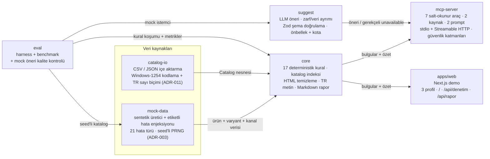
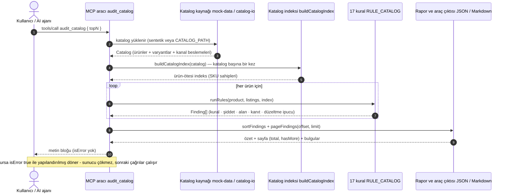
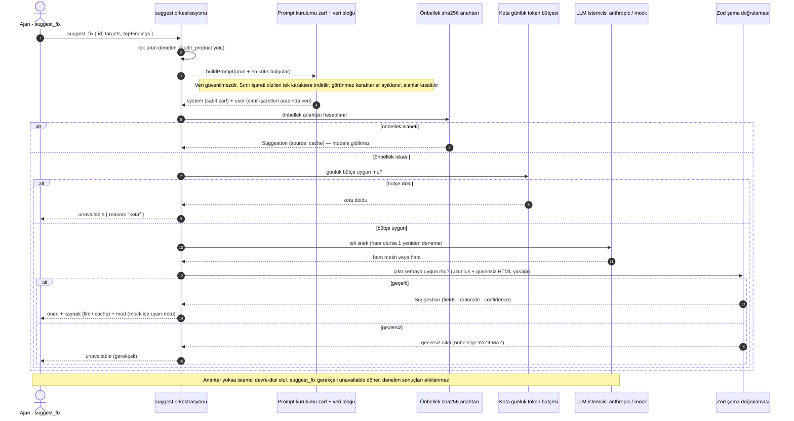

# Mimari

Bu belge, `pazaryeri-denetci-mcp` monorepo'sunun paket yapısını ve iki kritik akışını **mermaid**
diyagramlarıyla gösterir. Diyagramlar depodaki gerçek yapıya dayanır: 6 paket
(`core`, `mock-data`, `catalog-io`, `suggest`, `eval`, `mcp-server`) ve 1 uygulama (`apps/web`).

## Paketler ve veri yönleri

**Okunuşu.** Katalog iki kaynaktan gelir: `mock-data` (seed'li sentetik üretici; her enjekte ettiği
hatayı **etiketler**, eval'ın "gerçek doğruluk" verisi bu etiketlerdir) ve `catalog-io` (CSV/JSON
içe aktarma; Windows-1254 ve `1.299,90` gibi Türkçe sayı biçimlerini çözer). İkisi de `core`'a bir
**Catalog** nesnesi verir.

`core` tek başına denetim motorudur: 17 kuralı çalıştırır, ürün-ötesi kurallar için katalog başına
**bir kez** indeks kurar (ör. ürünler arası SKU çakışması), bulguları kararlı biçimde sıralar ve
Markdown/JSON rapor üretir. Tüketicileri iki tanedir: `mcp-server` (ajanlar için) ve `apps/web`
(sunucu bileşenlerinde aynı fonksiyonları çağıran demo).

`suggest` LLM öneri katmanıdır ve **denetimi etkilemez**: yalnızca `mcp-server`'a öneri döner. Girdiyi
sabit "zarf" (system) + etkisizleştirilmiş "veri bloğu" olarak ayırır, çıktıyı Zod ile doğrular ve
önbellek/kota ile maliyeti sınırlar (ADR-016).

`eval` hepsinin üstünde bir doğrulama hattıdır: `mock-data`'dan katalog üretir, `core`'da koşturup
precision/recall hesaplar, benchmark yapar ve `suggest`'i **mock istemciyle** uçtan uca sınar.

## Tek bir denetim akışı

**Okunuşu.** Ajan bir araç çağırır; sunucu önce katalog kaynağını çözer (varsayılan: sentetik
üretici, isteğe bağlı `CATALOG_PATH`). Katalog geneli indeks **tek sefer** kurulur ve bütün ürünler
aynı indeksi paylaşır. Ardından kural kayıt defteri ürün başına koşar ve `Finding` listesi üretir.
Bulgular kararlı biçimde sıralanır (`kritik → orta → düşük`), sayfalanır ve tek bir JSON metin bloğu
olarak döner. Hata yolu ayrıdır: çağrı `isError: true` ile yapılandırılmış hata döndürür ve sunucu
ayakta kalır.

## LLM öneri hattı (ayrı akış)

**Okunuşu.** Öneri isteği, tekil ürün denetiminin bulgularını temel alır. Prompt iki parçaya
ayrılır: **sabit zarf** (görev + kurallar, yalnızca bizim yazdığımız metin) ve **veri bloğu**
(güvenilmeyen ürün alanları + bulgu metinleri). Veri bloğuna girmeden önce metin etkisizleştirilir
ve kısaltılır; böylece model, veri içinde sınır işareti taklit edip "veri bitti" sanısına
düşürülemez. Aynı girdi (model + alanlar + veri) ikinci kez sorulursa sha256 anahtarıyla
**önbellekten** döner ve modele gidilmez.

Önbellek ıskasında günlük token bütçesi kontrol edilir; bütçe doluysa istek yapılmaz ve `kota`
gerekçesiyle `unavailable` döner. Bütçe uygunsa istemci çağrılır (tek yeniden deneme hakkı vardır)
ve ham çıktı **Zod** ile doğrulanır: uzunluk sınırları, en az bir öneri alanı ve güvensiz HTML
yasağı (`script`, `iframe`, `javascript:`, olay işleyicileri). Geçersiz çıktı öneri sayılmaz ve
**önbelleğe yazılmaz**. Anahtar/model yoksa istemci `devre-disi` olur; araç gerekçeli `unavailable`
döner ve **denetim sonuçları bundan etkilenmez** (denetimin tek kaynağı deterministik kurallardır).

## Bu diyagramlar neyi göstermiyor

- **Gerçek pazaryeri entegrasyonu yok.** Diyagramlarda hiçbir pazaryeri/Shopify API'si, kimlik
  doğrulama akışı veya canlı veri beslemesi görünmez; veri yükleme **CSV/JSON** ya da sentetik
  üretici iledir. Bu, bilinçli bir kapsam sınırıdır (ADR-008, ADR-011).
- **Mock-first.** `mock-data` ürünün tek veri üreticisidir ve `eval` ile öneri kalite kontrolü
  **sahte (mock) istemciyle** koşar; canlı model ölçümü bu ortamda yapılmadı (API anahtarı yok,
  ADR-003 ve ADR-016).
- **Sunucusuz (serverless) MCP ertelendi.** Diyagramdaki `mcp-server`, kalıcı bir Node sürecidir
  (stdio + Streamable HTTP). Vercel benzeri ortamlar için `createMcpHandler` + web-standard
  `Request`/`Response` tabanlı bir Next.js route'u **kapsam dışı bırakıldı** ve
  `docs/DECISIONS.md` → **Sapmalar / ertelenenler (2)** başlığında kayda geçirildi.
- **Yazma yolu yok.** Araç yüzeyinde yazma niteliğinde tek bir araç bulunmaz; `suggest_fix` de
  yalnızca öneri döner. İleride yazma eklenirse `dryRun` + açık onay + denetim kaydı zorunludur
  (ADR-013).
- **Çok örnekli ölçekleme yok.** Önbellek ve kota **süreç belleğindedir**, süreç başına sayılır;
  birden çok örnek için ortak dış sayaç gerekir ve bu kapsam dışıdır (`docs/LLM.md`).
- **Akış (stream) tabanlı içe aktarma yok.** Katalog tamamen bellekte tutulur; bu yüzden 10.000 ürün
  ~223 MB RSS'e karşılık gelir ve içe aktarma `CsvImportOptions.maxRows` ile sınırlanır (bkz.
  `docs/PERFORMANS.md`).
